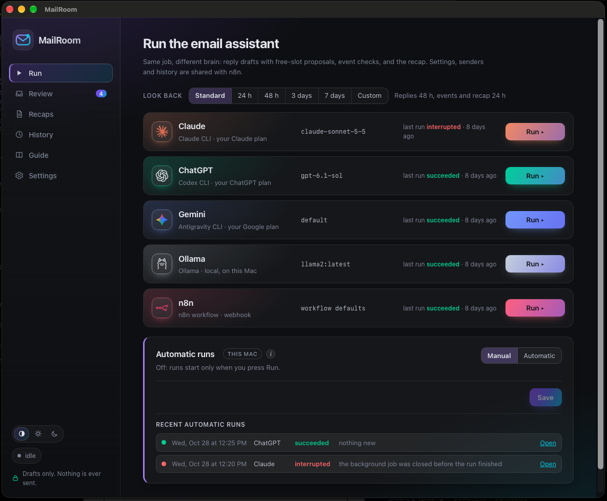
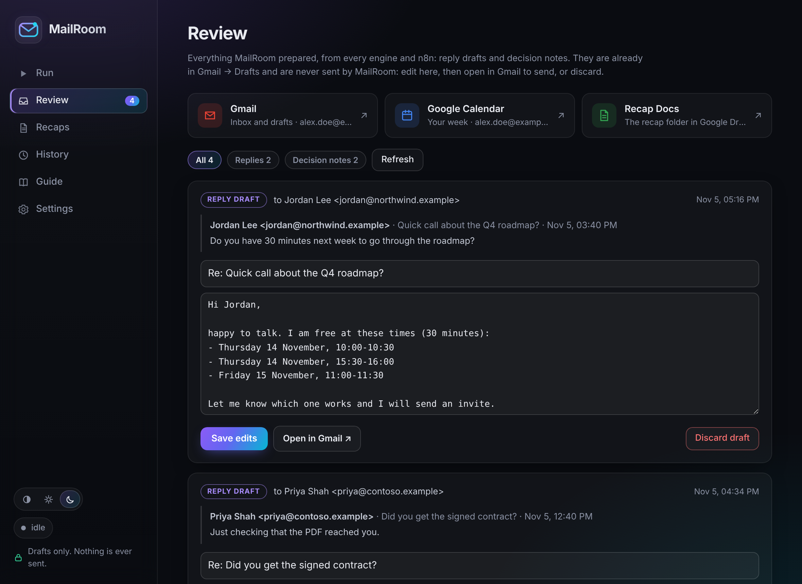
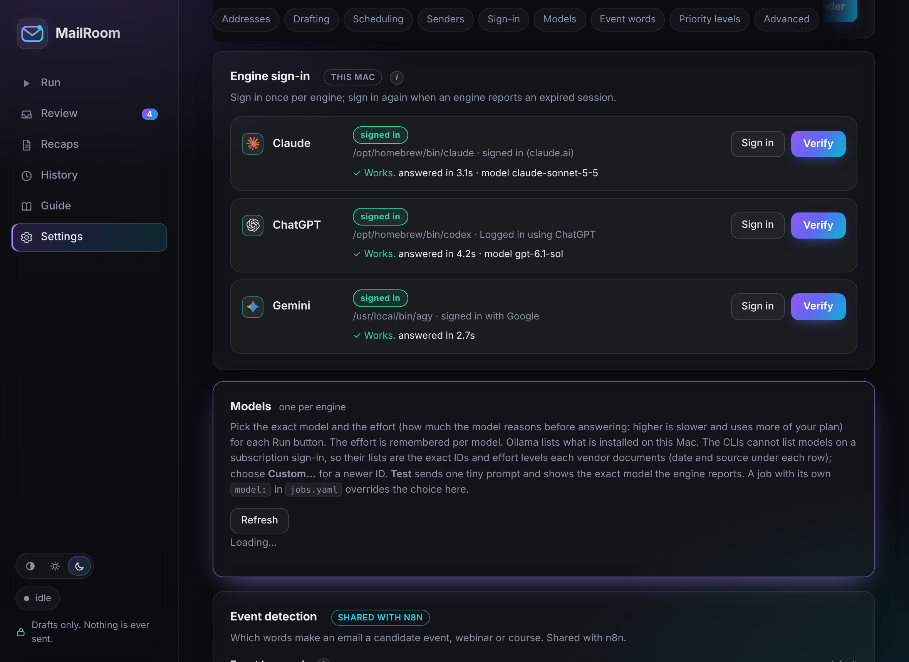

# MailRoom

MailRoom is a local Mac app for AI-assisted email triage on Gmail. You choose an engine and press
**Run**, or let it run on a schedule. Each run:

- **drafts replies** to emails that expect an answer, including meeting requests (with real free
  slots from your calendars) and "did you get the document I sent?" questions (it searches your
  mailbox first);
- **checks events**, webinars and courses against your calendars and leaves a FREE / CONFLICT note;
- **writes a recap** of recent mail, ranked by priority, in the app and in a Google Doc.

**Nothing is ever sent.** Everything lands in Gmail → Drafts for you to review, edit and send.



## Engines

The same job runs on five engines. The model only reads and writes text; MailRoom itself makes
every Gmail, Calendar and Docs call.

| Engine | Runs through | Billing |
|---|---|---|
| Claude | Claude Code CLI (`claude -p`) | your Claude plan |
| ChatGPT | Codex CLI (`codex exec`) | your ChatGPT plan |
| Gemini | Antigravity CLI (`agy -p`) | your Google sign-in |
| Ollama | a local model | free, nothing leaves your Mac |
| n8n | the workflows in `n8n/` | your n8n instance |

## Features

- **Review**: every draft and note from every engine in one list; edit, open in Gmail, or discard.
- **Recaps**: priority-ranked summaries, with the priority rubric editable in Settings.
- **Automatic runs**: pick an engine, days, times, a look-back window and optional allowed hours.
  Runs happen in the background (a macOS LaunchAgent), even with the window closed, and the app
  tells you which ones succeeded or failed.
- **Engine sign-in**: sign in to each CLI from Settings and verify it with one tiny prompt.
- **Meeting scheduling**: working-hour windows per category, busy calendars, booking calendars;
  calendar changes happen only after you open a decision link and press Confirm.

| Review | Settings |
|---|---|
|  |  |

The Review and Settings screenshots use sample data.

## Safety and privacy

- MailRoom never sends email. It creates drafts; notes have no recipient.
- Secrets (Google tokens, API keys, the webhook key) live in the macOS Keychain. The app's API
  only reports whether a secret is set, never its value.
- The server listens on `127.0.0.1` only.
- The CLI engines run in an empty temporary folder with tools and MCP servers switched off; the
  email goes in on stdin.
- Your data stays in `data/` (SQLite database, logs) and `config/`, both excluded from git.

## Install

See **[docs/INSTALL.md](docs/INSTALL.md)** for the full setup. In short:

```bash
git clone https://github.com/Marco-Sau/MailRoom.git
cd MailRoom
./scripts/dev.sh            # creates .venv, copies the example configs, serves http://127.0.0.1:8765
./scripts/build_app.sh      # optional: dist/MailRoom.app, a double-clickable launcher
```

Then connect Google, n8n and at least one engine in **Settings**. n8n setup:
**[docs/N8N_SETUP.md](docs/N8N_SETUP.md)**.

## Requirements

- macOS 12 or later, Python 3.11 or later.
- A Google account and your own Google Cloud OAuth client (Desktop app).
- An n8n instance with Data tables and the public API: MailRoom keeps its shared settings and
  history there, for every engine.
- At least one engine: Claude Code, Codex or Antigravity CLI signed in, or Ollama.

## How it works

```
web UI (vanilla JS, native window via pywebview)
   │  HTTP, 127.0.0.1 only
FastAPI ──► assistant runner ──► Gmail / Calendar / Docs APIs (the app makes every call)
   │            │  model: claude -p | codex exec | agy -p | Ollama   (classifies and writes text)
   │            └─ shared state ──► n8n data tables ◄── n8n workflows (the "n8n" engine)
   ├─► LaunchAgent ──► `mailroom autorun` (automatic runs)
   ▼
SQLite (runs, history)          macOS Keychain (keys, Google tokens)
```

## Command line

```bash
mailroom jobs                          # list the configured engines
mailroom run email-assistant-claude    # one headless run, prints the result as JSON
mailroom-desktop                       # server + native window
```

## Limitations

- macOS only (Keychain, LaunchAgent, launcher).
- Google: an OAuth app in "Testing" gets refresh tokens that expire after 7 days (see
  docs/INSTALL.md). Gmail's restricted scopes need Google verification before you could offer
  the app to other people with *your* OAuth client: everyone uses their own.
- Event detection keywords cover English and Italian; add your own in Settings → Event words.
- Model names change often: check them in Settings → Models.

## Tests

```bash
./.venv/bin/pytest -q
```

## License

MIT, see [LICENSE](LICENSE).
